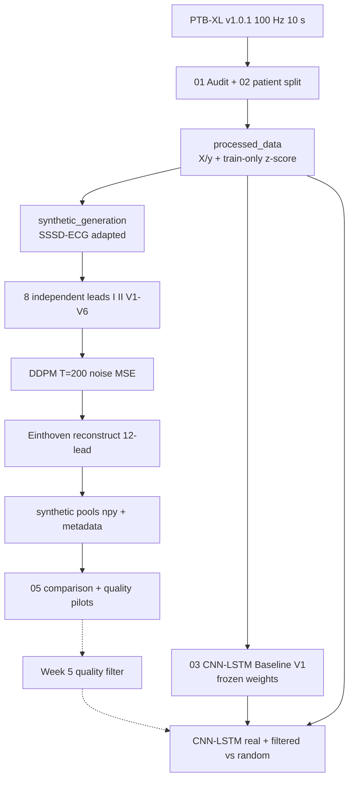
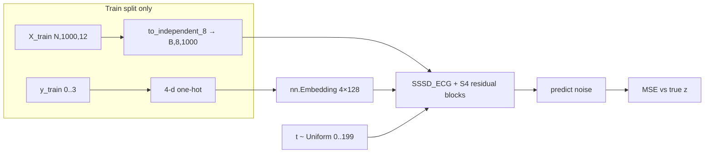
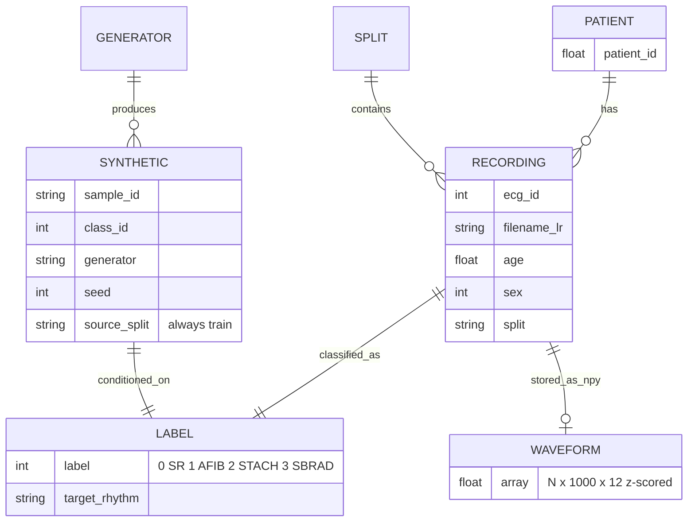

# PROJECT.md

**Name:** Quality-Aware Synthetic Data Augmentation for Robust Imbalanced ECG Classification  
**One-line description:** Generate class-conditional 12-lead ECGs on PTB-XL and (later) test whether quality-aware selection of those samples improves imbalanced rhythm classification versus random synthetic mix-in or real data only.  
**Purpose:** SR dominates the four-class subset (~85%). The frozen real-only CNN-LSTM is weakest on SBRAD (test F1 0.50, mainly SR→SBRAD). The project asks whether *selected* synthetic minority ECGs help more than dumping unfiltered synthetics into training.  
**Target users:** The student team and supervising professor; anyone reproducing the eight-week pipeline. Not a clinical product and not an end-user app.  
**Tech stack:** Python, Jupyter, PyTorch, NumPy/Pandas, scikit-learn, WFDB, Matplotlib, Einops / Opt-Einsum (S4), SciPy (peak HR in comparison metrics).  
**Current status:** Research prototype, pipeline complete (2026-10-25). Whole-ECG SSSD replaced by beat-template diffusion + rule-based rhythm assembly; quality filter, main experiment (5 conditions × 10 seeds) and statistics done. Results and limitations: `report/REPORT.md`. Sections below describe the Week 1–4 state unless marked updated.  
**Anything else:** Remote: [github.com/shivankmishra144droid/Quality-Aware-Synthetic-Data-Augmentation-for-ECG-Classification](https://github.com/shivankmishra144droid/Quality-Aware-Synthetic-Data-Augmentation-for-ECG-Classification). Hardware used: RTX 3050 Laptop **4 GB**. Do not call the 8×64 net the published SSSD-ECG (that is 36×256). Frozen Week 2–3 artifacts must not be overwritten. Generation never uses val/test waveforms.

---

## 1. Overview

This repository is an **eight-week research codebase** on [PTB-XL v1.0.1](https://physionet.org/content/ptb-xl/1.0.1/) (100 Hz, 10 s, 12-lead). It is **not** a web service, **not** a new generative architecture, and **not** a claim of SOTA on all PTB-XL rhythm codes.

**Problem:** Four exclusive SCP rhythm labels **SR / AFIB / STACH / SBRAD** are heavily imbalanced. A small CNN-LSTM trained on real train data only already reaches test accuracy **0.918** and Macro-F1 **0.783**, but SBRAD F1 is **0.50**.

**Intended solution (full project):**

1. Patient-level split + train-only per-lead z-score (frozen).
2. Real-only CNN-LSTM baseline (frozen).
3. Class-conditional synthetic 12-lead ECGs from **train only**.
4. **Week 5:** quality filter (keep vs discard) — **not done**.
5. Retrain the same classifier with real + filtered vs real + random synthetics (same ratio) — **not done**.

**Key features that exist today**

| Feature | Status |
|---------|--------|
| PTB-XL audit and 4-class definition | Done (`01_`, `02_`) |
| Frozen processed labels / stats | Done (`processed_data/`; `X_*.npy` rebuilt locally) |
| Frozen CNN-LSTM Baseline V1 | Done (`baseline/`) |
| Adapted SSSD-ECG train + sample | Done (`synthetic_generation/`, `04_`) |
| Honest generator comparison (1/4 runnable) | Done (`05_`, `generator_comparison/`) |
| Quality-improvement pilots (iters, width, CFG) | Done as isolated runs |
| Quality-aware filter + mix-in experiment | Done (updated): `quality_filter.py`, `augment_experiment.py`, `stats.py`; see `report/REPORT.md` |

**Research question**

> Can quality-aware selection of synthetic ECG samples improve imbalanced ECG classification compared with random synthetic augmentation?

---

## 2. Table of Contents

1. [Overview](#1-overview)
2. [Table of Contents](#2-table-of-contents)
3. [Tech Stack](#3-tech-stack)
4. [Architecture](#4-architecture)
5. [Folder Structure](#5-folder-structure)
6. [Getting Started](#6-getting-started)
7. [Features in Detail](#7-features-in-detail)
8. [Database / Data Models](#8-database--data-models)
9. [API Reference](#9-api-reference)
10. [Authentication & Security](#10-authentication--security)
11. [Configuration](#11-configuration)
12. [Testing](#12-testing)
13. [Deployment](#13-deployment)
14. [Coding Conventions](#14-coding-conventions)
15. [Known Issues & Limitations](#15-known-issues--limitations)
16. [Roadmap](#16-roadmap)
17. [Troubleshooting / FAQ](#17-troubleshooting--faq)
18. [Contributing Guide](#18-contributing-guide)
19. [License & Credits](#19-license--credits)

---

## 3. Tech Stack

| Piece | Purpose |
|-------|---------|
| **Python 3.10+** (recommended in README; exact patch TODO) | Runtime |
| **Jupyter** | Week notebooks `01`–`05` |
| **PyTorch** | CNN-LSTM + SSSD diffusion. Baseline was trained on **CPU**. Generator **requires CUDA**. README: install a CUDA wheel that matches the driver, then the rest of `requirements.txt`. |
| **NumPy / Pandas** | Arrays, metadata CSVs |
| **scikit-learn** | Split helpers / classification metrics in notebooks |
| **wfdb** | Read PTB-XL records from the local PhysioNet archive |
| **matplotlib** | Plots in notebooks and `generator_comparison/plots/` |
| **einops**, **opt_einsum** | S4 layer (`synthetic_generation/s4.py`) |
| **SciPy** (`scipy.signal.find_peaks`) | Lead-II peak **HR** in `generator_comparison/eval_metrics.py`. **Not listed in `requirements.txt`** (often pulled in with scientific stack; pin it if a clean venv fails). |
| **nbformat** | Used by `_build_w4.py` / `_build_compare.py` to regenerate notebooks. **Not listed in `requirements.txt`**. |
| **PTB-XL 1.0.1** (PhysioNet) | Source ECGs; local path under `archive/` (gitignored) |
| **GitHub** | Code hosting; 100 MB file cap → `X_*.npy` omitted from git |
| **CUDA GPU** | SSSD train/sample. Official 36×256 probed ~**8.2 GB**; this laptop used **8×64** (~1 GB train) |

No database server, no Docker, no cloud API, no frontend framework.

---

## 4. Architecture

End-to-end research pipeline (solid = implemented, dashed = not built):



**Generator internals (what actually trains):**



Sampling (optional CFG): `eps = eps_uncond + w * (eps_cond − eps_uncond)` with null cond = zero one-hot. Implemented in `synthetic_generation/utils.py`. Ran **w=2** and **w=4** only (`_run_cfg.py`). No **w=3**.

**Component map**

| Component | Role |
|-----------|------|
| Notebooks `01`–`05` | Human-run pipeline and write-up |
| `preprocess_ptbxl.py` | Tiny rhythm-count helper on the raw CSV (7 rhythms, not the frozen 4-class rule) |
| `synthetic_generation/` | Trainable generator package |
| `baseline/` | Frozen classifier contract |
| `generator_comparison/` | Pilot pools, metrics, not-runnable records |
| `_build_*.py`, `_run_*.py`, `_check_ab.py` | One-off experiment / notebook builders (not a library API) |

---

## 5. Folder Structure

```
ECG - GenAi/
├── PROJECT.md                          # This file
├── README.md                           # Short research README (CFG status there is stale vs sssd_cfg_w*)
├── requirements.txt                    # pip packages (scipy/nbformat not listed)
├── .gitignore                          # archive/, X_*.npy, most *.pt, .env, venv
├── 01_PTBXL_Data_Audit.ipynb           # Week 1: dataset audit
├── 02_PTBXL_Exploration.ipynb          # Week 2: 4-class set, split, z-score, save arrays
├── 03_CNN_LSTM_Baseline.ipynb          # Week 3: train/eval frozen CNN-LSTM
├── 04_Synthetic_ECG_Generation.ipynb   # Week 4: SSSD adapt, train, sample
├── 05_Generator_Comparison_Pilot.ipynb # Generator selection pilot (not Week 5)
├── preprocess_ptbxl.py                 # Prints 7-rhythm counts from ptbxl_database.csv
├── _build_w4.py                        # Regenerates 04_ notebook
├── _build_compare.py                   # Regenerates 05_ notebook
├── _run_sssd_v2.py                     # Isolated 4000→16000 iter run
├── _check_ab.py                        # Check A ckpt 2000; Check B 16×128
├── _run_cfg.py                         # CFG train + sample w=2 and w=4
├── archive/                            # Local PTB-XL (gitignored)
├── OBSIDIAN/                           # Local notes (gitignored)
├── processed_data/                     # Frozen split + labels + stats
│   ├── dataset_config.json             # Seed, classes, counts, lead order
│   ├── label_mapping.json              # SR=0 … SBRAD=3
│   ├── normalization_stats.json        # Train-only per-lead mean/std
│   ├── train|val|test_metadata.csv     # ids, labels, filenames
│   ├── y_train|val|test.npy            # Integer labels
│   └── X_train|val|test.npy            # Waveforms; gitignored; rebuild from 02
├── baseline/                           # Frozen Baseline V1 — do not retrain
│   ├── cnn_lstm_baseline.pt            # Best epoch 12 (git exception)
│   ├── config.json                     # Arch + train hyperparams
│   ├── metrics.json                    # Test Macro-F1 0.783, acc 0.918
│   ├── class_weights.json              # Weighted CE from train labels
│   ├── confusion_matrix.csv            # Test confusion
│   ├── history.json                    # Training history
│   └── label_mapping.json              # Same 4-class map
├── synthetic_generation/               # Adapted SSSD-ECG package
│   ├── config.py / config.json         # Diffusion, 36×256 vs 8×64, sample counts
│   ├── data.py                         # TrainECG8 from X_train only
│   ├── leads.py                        # 8↔12 lead conversion
│   ├── model.py                        # SSSD_ECG (official structure, 4-class embed)
│   ├── s4.py                           # S4 layer
│   ├── utils.py                        # DDPM loss, CFG sample, seed
│   ├── train.py                        # CUDA train loop, VRAM-based width
│   ├── sample.py                       # Class-conditional sample + sanity
│   ├── history.json                    # Pilot/full train logs
│   ├── checkpoints/                    # *.pt gitignored except comparison copy
│   └── samples/                        # Intermediate npy
├── synthetic_data/                     # Week 4 pool 16/32/32/48 — do not overwrite
│   ├── X_synthetic.npy / y_synthetic.npy
│   └── metadata.csv
└── generator_comparison/
    ├── eval_metrics.py                 # std, Lead-II HR, pairwise corr (not Week 5)
    ├── metadata/selection.json         # Why SSSD was selected
    ├── comparison_results/             # v1 table + sssd_metrics.json + HR CSV
    ├── plots/                          # Lead-II / SBRAD comparison figures
    ├── sssd/                           # Selected 32/class pool + tracked checkpoint.pt
    ├── transdiff|sediff|flowecg/       # NOT_RUNNABLE.json only
    ├── sssd_v2/                        # 16000-iter pilot + STEP1/2 diagnosis
    ├── sssd_ckpt2000/                  # Sample from 2000-iter snapshot
    ├── sssd_v3/                        # 16×128 capacity
    ├── sssd_cfg/                       # CFG train plan + cfg_comparison.json
    ├── sssd_cfg_w2/                    # Sampled CFG guidance_w=2
    └── sssd_cfg_w4/                    # Sampled CFG guidance_w=4
```

Git tracks `generator_comparison/sssd/X_synthetic.npy` (small comparison pool). Week-4 `processed_data/X_*.npy` stay gitignored. Local CFG `w2`/`w4` npy may be untracked; metrics JSON is the source of truth for numbers below.

---

## 6. Getting Started

### Prerequisites

- Python 3.10+ (README).
- NVIDIA GPU + CUDA PyTorch **required** to train or sample SSSD (`train.require_cuda()`).
- Baseline weights can be **loaded** without GPU; original training was CPU.
- Disk for PTB-XL (~several GB) if you need to rebuild `X_*.npy`.
- PhysioNet access to download PTB-XL 1.0.1.

### Installation

```bash
git clone https://github.com/shivankmishra144droid/Quality-Aware-Synthetic-Data-Augmentation-for-ECG-Classification.git
cd Quality-Aware-Synthetic-Data-Augmentation-for-ECG-Classification
python -m venv .venv
# Windows:
.venv\Scripts\activate
# Linux/macOS:
# source .venv/bin/activate

# CUDA torch first (example — pick the wheel for YOUR driver from pytorch.org)
pip install torch --index-url https://download.pytorch.org/whl/cu128
pip install -r requirements.txt
pip install scipy nbformat
```

TODO: pin exact `torch` / CUDA versions used on the author machine in `requirements.txt`.

### Environment variables

There is **no application `.env` schema**. `.gitignore` ignores `.env` / `credentials.json` as a precaution. PhysioNet download credentials are **not** stored in this repo.

Example (optional local notes only):

```bash
# .env.example — unused by code today
# PHYSIONET_USER=
# PHYSIONET_PASSWORD=
```

### Data layout

Download [PTB-XL 1.0.1](https://physionet.org/content/ptb-xl/1.0.1/) and place it at:

```
archive/ptb-xl-a-large-publicly-available-electrocardiography-dataset-1.0.1/
```

Then rebuild waveforms:

```bash
jupyter notebook 02_PTBXL_Exploration.ipynb
```

Run the dataset-finalization cells so `processed_data/X_train.npy` etc. exist. Labels `y_*.npy` and `normalization_stats.json` are already in git.

### How to run (dev)

Notebooks **in order**. For Week 3+, **load frozen weights**; do not retrain the baseline to chase later metrics.

```bash
jupyter notebook 01_PTBXL_Data_Audit.ipynb
jupyter notebook 02_PTBXL_Exploration.ipynb
jupyter notebook 03_CNN_LSTM_Baseline.ipynb
jupyter notebook 04_Synthetic_ECG_Generation.ipynb
jupyter notebook 05_Generator_Comparison_Pilot.ipynb
```

Isolated generator experiments (CUDA, from repo root):

```bash
python _run_sssd_v2.py
python _check_ab.py
python _run_cfg.py
```

These write under `generator_comparison/` and must **not** overwrite `synthetic_data/` or `generator_comparison/sssd/` unless you intend to break the selected-pool contract.

### Production

Does not apply. There is no production server, Docker image, or packaged CLI.

---

## 7. Features in Detail

### 7.1 Four-class PTB-XL subset and split

- Keep a recording iff **exactly one** of `{SR, AFIB, STACH, SBRAD}` is in `scp_codes`. Conflicts among these four: **0**. AFLT / SARRH / SVTAC are out of the primary experiment.
- **Patient-level** 70/15/15, seed **42**, stratified on patient primary rhythm. Not PTB-XL `strat_fold`.
- Train ∩ val ∩ test patients = **0**.
- Shape `(N, 1000, 12)`, lead order I, II, III, aVR, aVL, aVF, V1–V6.
- Z-score: **train-only** per-lead mean/std; apply to val/test.

**Files:** `02_PTBXL_Exploration.ipynb`, `processed_data/dataset_config.json`, `normalization_stats.json`, `*_metadata.csv`, `y_*.npy`.

| Split | Recordings | Patients | SR | AFIB | STACH | SBRAD |
|-------|----------:|---------:|---:|-----:|------:|------:|
| Labelled 4-class | 19,759 | 17,320 | — | — | — | — |
| Train | 13,811 | 12,124 | 11,741 | 1,056 | 568 | 446 |
| Val | 2,960 | 2,598 | 2,515 | 224 | 125 | 96 |
| Test | 2,988 | 2,598 | 2,526 | 234 | 133 | 95 |

### 7.2 Frozen CNN-LSTM baseline

`CNNLSTM` in `03_CNN_LSTM_Baseline.ipynb`: Conv1d 12→32 k=7 + BN + ReLU + MaxPool(4) → Conv1d 32→64 k=5 + BN + ReLU + MaxPool(4) → LSTM(64, hidden 64) → Dropout 0.3 → Linear 4. **46,756** params. Adam lr 1e-3, weighted CE (train labels only), val Macro-F1 selection, best epoch **12**, CPU.

**Test:** accuracy **0.918**, Macro-F1 **0.783**. Per-class F1: SR **0.955**, AFIB **0.877**, STACH **0.805**, SBRAD **0.497**. Confusion: **122** true SR predicted SBRAD.

**Files:** `baseline/cnn_lstm_baseline.pt`, `metrics.json`, `config.json`, `confusion_matrix.csv`.

### 7.3 Adapted SSSD-ECG generation

Adapted from [AI4HealthUOL/SSSD-ECG](https://github.com/AI4HealthUOL/SSSD-ECG): DDPM **T=200**, β 1e-4 → 0.02, 8-channel WaveNet+S4, **4-class** one-hot (not 71 SCP). Independent leads **I, II, V1–V6**; reconstruct III = II−I, aVR = −(I+II)/2, aVL = I−II/2, aVF = II−I/2.

VRAM &lt; 8 GB → **WAVENET_4GB** 8 layers × 64 channels (~1.53M params). Official **36×256** only if VRAM ≥ 8 GB. Batch **1**, AMP **off** (S4 `rfft` / cuFFT). Train on `X_train`/`y_train` only. Default full run **4000** iters, lr **2e-4**, seed **42**.

Week 4 pool (`synthetic_data/`): SR 16, AFIB 32, STACH 32, SBRAD 48. Comparison pool (`generator_comparison/sssd/`): **32/class**.

**Files:** `synthetic_generation/{config,model,s4,train,sample,leads,data,utils}.py`, `04_Synthetic_ECG_Generation.ipynb`.

### 7.4 Generator comparison (honest)

Four names, **one runnable**. Seeds 43/44 used for probes that never ran.

| Generator | Result |
|-----------|--------|
| SSSD-ECG adapted | Selected. 128/128 valid. Peak train ~0.98 GB. |
| TransDiffECG | No public code; paper on QTDB/LUDB. |
| SE-Diff | Public repo needs unpublished latents/VAE/embeddings; batch 4096. |
| FlowECG | No public official repo; do not reimplement by editing the SSSD sampler. |

**Files:** `05_Generator_Comparison_Pilot.ipynb`, `metadata/selection.json`, `*/NOT_RUNNABLE.json`, `comparison_results/`.

### 7.5 Quality-improvement pilots (not Week 5)

Isolated changes. Frozen v1 pool left in `generator_comparison/sssd/`.

| Run | Change | Syn std (real = 1.018) | Class HR |
|-----|--------|------------------------|----------|
| v1 | 8×64, 4000, no CFG | **0.495** | All ~130 bpm |
| v2 | resume → 16000 | 0.473 | Still mixed |
| ckpt2000 | sample iter 2000 | 0.460 | Still mixed |
| v3 | 16×128, 4000 scratch | 0.582 | Still mixed |
| CFG w=2 | 10% label dropout, w=2 | 0.565 | Still mixed |
| CFG w=4 | same ckpt, w=4 | **0.949** | Still mixed (~133); SBRAD pairwise corr **0.90** |

Diagnosis (`sssd_v2/STEP1.md`): conditioning is wired; no denorm bug; T=200 already; 4000 iters is a weak training budget.

**std** = global SD of all samples × 12 leads × 1000 in **z-score space** (amplitude), not HRV. **HR** = heart rate from Lead-II `find_peaks` (distance 0.30 s, prominence 0.35), **not** clinical HR.

### 7.6 Week 5 quality filter

**Updated: implemented.** `generator_comparison/quality_filter.py` (typicality + frozen-baseline label probability + out-of-fold realism log-odds, combined as within-class ranks). Sanity check: TSTR top 0.743 > random 0.672 > bottom 0.582. Main result: exploratory filtered vs random +0.010 macro-F1 (p = 0.065); pre-registered confirmatory study (30 new seeds) found no difference (+0.0014, p = 0.79). See `report/REPORT.md`.

---

## 8. Database / Data Models

No SQL/NoSQL database. Arrays + JSON + CSV.



**`processed_data/*_metadata.csv` columns:** `ecg_id`, `patient_id`, `target_rhythm`, `label`, `split`, `filename_lr`, `age`, `sex`.

**`synthetic_data/metadata.csv` / comparison metadata:** `sample_id`, `class_id`, `class_name`, `generator`, `seed`, `source_split`, `sampling_rate`, `duration_seconds`, `num_leads`, `sample_index`.

**Checkpoint dict keys** (`train.py`): `iter`, `model_state_dict`, `optimizer_state_dict`, `train_cfg`, `wavenet_config`, `diffusion_config`.

---

## 9. API Reference

Does not apply. There are **no HTTP endpoints**. The “API” is Python functions, for example:

| Function | Module | Role |
|----------|--------|------|
| `train_loop(...)` | `synthetic_generation.train` | CUDA training |
| `generate_class_batch(...)` | `synthetic_generation.sample` | Class-conditional 12-lead batch |
| `load_train()` | `synthetic_generation.data` | `X_train.npy` / `y_train.npy` |
| `summarize_generator(...)` | `generator_comparison.eval_metrics` | Pilot metrics |

---

## 10. Authentication & Security

Does not apply as an application (no users, sessions, or roles).

Practices that **do** apply:

- Val/test waveforms are **never** used to train the generator (`data.py` loads train only).
- Patient-level split prevents the same person in train and test.
- No pretrained SSSD weights (would risk leakage / license issues).
- `.env`, `*.pem`, `credentials.json` are gitignored.
- Do not commit raw `archive/` PTB-XL.
- This is **not** a diagnostic device; synthetic ECGs are research artifacts.

TODO: PhysioNet credentialed-data usage terms if you redistribute derived waveforms.

---

## 11. Configuration

No runtime environment-variable table. Knobs live in JSON/Python.

| Key | Where | Typical value | Meaning |
|-----|--------|---------------|---------|
| `SEED` | `config.py` | 42 | Split, baseline, selected SSSD |
| `T`, `beta_0`, `beta_T` | `DIFFUSION_CONFIG` | 200, 1e-4, 0.02 | DDPM schedule |
| `num_res_layers` × `res_channels` | `WAVENET_CONFIG` / `_4GB` | 36×256 vs 8×64 | Capacity |
| `label_embed_classes` | wavenet dict | 4 | Not 71 SCP |
| `n_iters` | `TRAIN_FULL` | 4000 | Full Week-4 train |
| `batch_size` | train cfg | 1 | VRAM |
| `learning_rate` | train cfg | 2e-4 | Adam |
| `use_amp` | train cfg | false | S4 FFT |
| `label_dropout_p` | `train_loop` / CFG | 0.10 | CFG train |
| `guidance_w` | `sampling_label` | 2.0 or 4.0 | CFG sample; no 3.0 run |
| CNN `lr` / `batch_size` / `max_epochs` | `baseline/config.json` | 1e-3 / 64 / 25 | Frozen baseline |
| Class weights | `baseline/class_weights.json` | SR 0.29 … SBRAD 7.74 | Weighted CE |

VRAM gate: `select_wavenet()` uses official 36×256 only if `total_memory/1024³ >= 8`.

---

## 12. Testing

Does not apply as an automated suite. **No** `tests/`, pytest, or CI.

Practical checks used in-repo:

- Notebook sanity prints and `basic_sanity()` (NaN, flatline, extreme z-score amp, shape).
- `eval_metrics.py` vs real train (`waveform.std`, Lead-II HR, pairwise corr, corr vs real &gt; 0.95).

TODO: unit tests for `leads.reconstruct_12` invertibility and split-disjoint patients.

---

## 13. Deployment

Does not apply. No hosting, Docker, or GitHub Actions in this repository.

GitHub is source hosting only. Large npy/checkpoints are gitignored because of the **100 MB** file limit.

---

## 14. Coding Conventions

Observed in the repo (nothing extra is written as a style guide):

| Topic | Practice |
|-------|----------|
| Language | Python 3 type hints in `synthetic_generation/` (`from __future__ import annotations`) |
| Names | `snake_case` functions; `SSSD_ECG`, `CNNLSTM`, `TrainECG8` classes |
| Experiments | **One isolated change** per run; write a new `generator_comparison/sssd_*` folder |
| Frozen contracts | Do not retune `baseline/` or rewrite `processed_data` stats to make synthetics look better |
| Seeds | 42 for the selected path; document other seeds |
| Honesty | If a generator is not runnable, write `NOT_RUNNABLE.json` — do not substitute a different model silently |
| Notebooks | Week scope in the title (Week 4 ≠ Week 5) |
| Branching | TODO: not documented. Current remote history is a single `main` commit (`d626724`) |
| Commits | TODO: no team template. Existing message is a long summary of the initial dump |

Ponytail / YAGNI: smallest change; no unrequested generators.

---

## 15. Known Issues & Limitations

- **Class-conditional heart rate is unsolved.** All synthetic classes sit ~130 bpm (peak detector). Real medians: SR ~84, AFIB ~117, STACH ~111, SBRAD ~96. CFG w=4 fixes **amplitude**, not period.
- **8×64 ≠ published SSSD-ECG.** 4 GB VRAM; 16×128 still did not fix HR.
- **Lead-II HR is a diagnostic**, not clinical rate. Extra synthetic peaks can inflate HR for every class.
- **CFG w=4** SBRAD pairwise correlation **0.90** (mode-collapse risk). Near-dup vs real train remains low (max corr ≪ 0.95).
- **README CFG bullet is stale** (“sampling/eval still in progress”); `sssd_cfg_w2` / `w4` metrics exist.
- **`scipy` / `nbformat` missing** from `requirements.txt`.
- **`preprocess_ptbxl.py` uses a 7-class first-match rule**, not the frozen exclusive 4-class pipeline — do not treat its counts as the experiment.
- **4000 iters, batch 1** sees a small fraction of 13,811 train ECGs; loss can dip then drift (v3).
- **AMP off**, batch 1 → slow training.
- **No Week 5 / no synthetic-in-classifier results.** Do not claim augmentation helped Macro-F1.
- **TransDiffECG / SE-Diff / FlowECG** were not run; no fake metrics.
- Git omits `processed_data/X_*.npy`; clones cannot train the generator until notebook 02 is rerun.
- `synthetic_generation/config.json` stores an **absolute local checkpoint path** from one machine.

---

## 16. Roadmap

- [ ] Confirm HR collapse with FFT / autocorrelation vs peak detector (same traces).
- [ ] Isolated **Prompt 2**: learning-rate / training dynamics on **same 8×64**, T=200; **not** another CFG `w`.
- [ ] Optional: class-balanced batches or explicit HR / period condition or spectral auxiliary loss (conditioning/loss, not a new paper model).
- [ ] Optional later: official **36×256** on a GPU with ≥8 GB as a **single** capacity check.
- [ ] Pass bar before Week 5: STACH vs SBRAD period moves in the **same direction as real**; std stays near **1**; SBRAD not collapsed.
- [ ] Week 5 quality filter (statistical / temporal / feature-space; keep vs discard).
- [ ] Retrain CNN-LSTM: real-only vs real+random syn vs real+filtered syn, **same mix ratio**, frozen preprocess.
- [ ] Pin `requirements.txt` (torch CUDA, scipy, nbformat).
- [ ] Do **not** mix synthetic pools into the classifier while class HR is collapsed.
- [ ] TODO: calendar deadline for the eight-week course is not in the repo.

---

## 17. Troubleshooting / FAQ

**`RuntimeError: CUDA is unavailable`**  
Install a CUDA PyTorch build. CPU is forbidden for `train_loop`.

**OOM on 36×256**  
Expected on 4 GB. Code falls back to 8×64 **only** if the attempted config was `WAVENET_CONFIG`. Forced 16×128 OOM is not auto-shrunk.

**`FileNotFoundError: X_train.npy`**  
Rebuild from `02_` after placing PTB-XL under `archive/`.

**Synthetic std ~0.5 vs real ~1.0**  
Open `generator_comparison/comparison_results/sssd_metrics.json` (`waveform.std` vs `real_waveform.std`). First pool is 8×64 / 4000 / no CFG. CFG w=4 → ~0.95. Not a forgotten denorm.

**Why is everything ~130 bpm?**  
Label embedding is a global add; loss is noise MSE; CFG scales amplitude. Peak detector may also over-count. See §15.

**Can I retrain the CNN-LSTM to look better?**  
No. That breaks the Week 3 contract.

**Is there w=3?**  
No. Only w=2 and w=4.

**Jupyter prints delayed**  
Known annoyance with buffered stdout in long train cells; experiment scripts print per log interval.

---

## 18. Contributing Guide

This is a course research repo. If you change anything:

1. Do not overwrite `processed_data` stats, `baseline/`, or `synthetic_data/` unless the team explicitly resets Week 2–4.
2. New generator runs go in a **new** `generator_comparison/<name>/` folder with `config.json`, `metrics.json`, `metadata.csv`.
3. One experimental factor at a time.
4. If a method is not runnable, document why; do not swap in another architecture under the same name.
5. Keep val/test out of generator training.
6. Prefer updating this `PROJECT.md` and `README.md` together when status changes (README currently lags CFG).

TODO: code owners, PR template, issue tracker process — not in repo.

---

## 19. License & Credits

**License:** TODO — no `LICENSE` file in the repository. Do not assume you may redistributed PTB-XL or SSSD-ECG weights/code beyond their original terms.

**This project** adapts SSSD-ECG (architecture + diffusion; width reduced for 4 GB; 4-class PTB-XL):

- Code: [AI4HealthUOL/SSSD-ECG](https://github.com/AI4HealthUOL/SSSD-ECG)
- Alcaraz, J. M. L., & Strodthoff, N. *Diffusion-based conditional ECG generation with structured state space models.* Computers in Biology and Medicine, 2023.

**PTB-XL:** Wagner, P., et al. *PTB-XL, a large publicly available electrocardiography dataset.* Scientific Data, 2020. PhysioNet [1.0.1](https://physionet.org/content/ptb-xl/1.0.1/).

**Not used as drop-in generators:** TransDiffECG, SE-Diff, FlowECG (see `NOT_RUNNABLE.json`). PPGFlowECG is a different method and was not substituted.

**Git:** `origin` → `https://github.com/shivankmishra144droid/Quality-Aware-Synthetic-Data-Augmentation-for-ECG-Classification.git`
