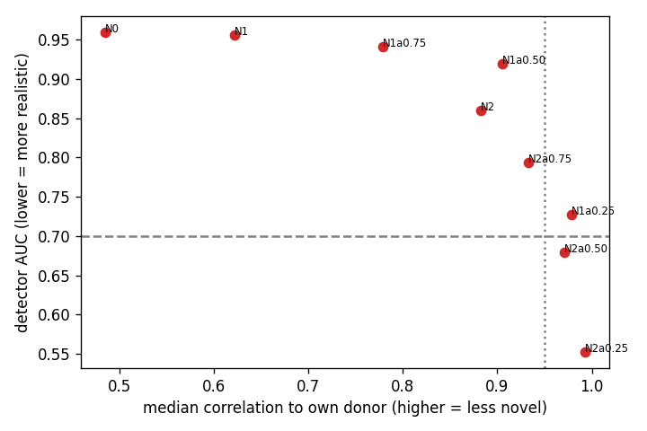

# Real-noise-bank variants (part B of `PREREGISTRATION_3.md` on this branch)

**Outcome: no variant passes the registered gate.** As registered, the result is the realism-novelty curve below,
reported as a finding. No pool is built and no follow-up classifier study is run.

Run 2026-10-30 on train and validation data only. `processed_data/X_test.npy` was not present in the working copy the
runs used, so the test split could not have been loaded. Raw numbers: `generator_comparison/noise_bank/results.{json,md}`,
`variants.json`; logs `variants_run.log`, `eval_run.log` (and `eval_run_crash_registered.log`, see D-B1).

## Why

Study 2's ablation (`_beat_ablation.py`) found:
- a real recording rebuilt from its own template, residual and wander is undetectable (E: AUC 0.51);
- swapping in another recording's template at the same R-peaks is caught (T_rand 0.956, T_match 0.947).

Algebraically, the swap is `donor + (T' − own_template)` placed at every R-peak: one difference waveform, repeated
identically at every beat. Part B asked whether aligning T' to the donor's beat (N1), picking the nearest generated
template (N2) and scaling the difference by α < 1 make the samples undetectable **while they stay new ECGs**.

## Variants and gate

Every variant is `donor + α·(T' − own template)` at the donor's own R-peaks, rebuilt to 12 leads. The donors are
1,496 real train ECGs: SR 500, AFIB 494, STACH 279, SBRAD 223. That is the ablation's draw (rng 7) minus 11 ECGs whose
beats could not be parsed. The templates come from `tstr/pool_beatgen.npz` and then `pools2/pool_1.npz`. A template
had to be reused for only 1 donor.

Gate (all must hold):
- detector AUC ≤ 0.70 (mean of seeds 0 and 1, donors excluded);
- all 9 scorecard checks pass;
- median correlation to the sample's own donor ≤ 0.95, and the share above 0.98 ≤ 1 %;
- TSTR balanced accuracy on real validation data ≥ beat_gen's at the same N (N = 200/class: beat_gen 0.686,
  real-data TRTR 0.796).

## Results

| variant | T' | α | detector AUC (seed 0 / 1) | scorecard | median donor corr | share > 0.98 | TSTR bal. acc | fails on |
|---|---|---|---|---|---|---|---|---|
| N0 | random, unaligned | 1 | **0.959** (0.966 / 0.953) | 9/9 | 0.485 | 0.001 | 0.777 | detector |
| N1 | random, aligned | 1 | 0.955 (0.954 / 0.956) | 9/9 | 0.622 | 0.001 | 0.768 | detector |
| N1a0.75 | random, aligned | 0.75 | 0.941 (0.927 / 0.955) | 9/9 | 0.779 | 0.003 | 0.784 | detector |
| N1a0.50 | random, aligned | 0.50 | 0.919 (0.912 / 0.926) | 8/9 | 0.905 | 0.011 | 0.780 | detector, memorised, novelty (share) |
| N1a0.25 | random, aligned | 0.25 | 0.727 (0.714 / 0.739) | 8/9 | 0.978 | 0.460 | 0.791 | detector, memorised, novelty |
| N2 | nearest, aligned | 1 | 0.859 (0.872 / 0.847) | 8/9 | 0.882 | 0.006 | 0.771 | detector, memorised |
| N2a0.75 | nearest, aligned | 0.75 | 0.793 (0.788 / 0.798) | 8/9 | 0.933 | 0.018 | 0.767 | detector, memorised, novelty (share) |
| N2a0.50 | nearest, aligned | 0.50 | 0.679 (0.651 / 0.707) | 8/9 | 0.970 | 0.223 | 0.806 | memorised, novelty |
| N2a0.25 | nearest, aligned | 0.25 | 0.552 (0.546 / 0.558) | 8/9 | 0.993 | 0.913 | 0.807 | memorised, novelty |

The only scorecard check that ever fails is `not_memorized`, and it fails for exactly the variants that are close to
their donors. All 9 checks pass for the real reference set (`real_ref_checks`).

**Sanity check.** N0 is the ablation's T_rand built again with the new code. It gives 0.959, against the ablation's
0.956.



## What it shows

- **One curve, no gap.**
  - Every variant lies on a single trade-off between realism and novelty.
  - The detector drops below 0.70 only for N2a0.50 and N2a0.25, and by then the median sample correlates 0.97–0.99
    with its own donor. 22–91 % of samples are above 0.98, which makes them near-copies.
  - Wherever the samples are novel enough (median ≤ 0.95 and ≤ 1 % above 0.98: N0, N1, N1a0.75, N2), the detector
    scores 0.86–0.96.
- **Alignment does almost nothing:** N0 0.959 vs N1 0.955.
- **Picking the nearest template helps, but only by making the change smaller.** N2 (0.859 at corr 0.88) sits below
  N1a0.50 (0.919 at corr 0.91). That is the same trend as the rest of the curve: the smaller the difference waveform,
  the less there is to catch.
- **TSTR doesn't separate the variants and says little about the generated beats.**
  - Every variant clears the beat_gen bar (0.767–0.807 vs 0.686).
  - But each sample keeps its donor's real rhythm, real noise and real wander. For these four rhythm classes, the
    R-R timing that carries most of the label is entirely real.
  - So high TSTR here mostly reflects the real donor. It is not evidence that generated templates train as well as
    real beats.

## Relation to study 4 (`report/STUDY4_OVERNIGHT.md` on `study2`)

Study 4 kept realistic templates and tried to make the *non-template* part realistic. Every attempt stayed detectable:
- a learned noise model: AUC 1.000;
- envelope-modulated noise: 0.998;
- template-relative beat variation: 0.94;
- real beat variation borrowed from another patient: 0.83.

Part B is the mirror experiment: the non-template part is a real ECG and only the template is generated. That is still
caught, unless the change is too small to make a new ECG. So the detector's cue is not only the synthetic noise. The
template substitution itself is detectable, which is consistent with the "one difference repeated at every beat"
reading.

Study 4 §1 found that beat-morphology measurements on their own (QRS width, R/S/T amplitude, ST level) do *not*
separate synthetic from real. Together, these suggest the giveaway is how the beat sits in the signal, from beat to
beat, rather than its average shape. Study 4 already tested per-beat variation without success, so it is not proposed
here as a fix.

## Outcome per the registration

The registered outcome for "none passes" is that the curve is the finding, and the study stops. No variant passed,
so the conditional time-warp variant (N4, `--warp-from`) was not built and no new pool or classifier study is
proposed.

## Limits

- **One detector** (`realism_detector`, 2 seeds) defines "undetectable". Other judges were not used.
- **The template banks are the current generator's** (`tpl_8x64_last.pt`). A better template generator could move the
  curve.
- **α was swept only at 0.25 / 0.50 / 0.75.** The curve between 0.25 and 0.50 for N2 is where the detector crosses
  0.70, and novelty has already failed there.
- **TSTR is measured at N = 200/class on validation**, three seeds, and is dominated by the real donor content (see
  above).
- `pool_beatgen.npz` is not hash-frozen in the registration. Its hash and the input hashes are recorded below.

## Deviations from `PREREGISTRATION_3.md` (this branch)

- **D-A (Part A not run, user decision, 2026-10-30).**
  - This branch was cut from an old `study2` (Phase 7, `ffefdc6`). Since then, `study2` has gained studies 3–5.
  - Part A's question (the threshold-tuned real-only control) is already covered by `THRESHOLD_EXPLORE.md`, study 4
    U2, and the draft `PREREGISTRATION_5.md`. Study 5 uses a separate calibration split, so validation is not reused
    for tuning.
  - Running Part A would have added another look at the test split, for a weaker design. So no
    `_run_threshold_control.py` or `_threshold_analysis.py` run took place, the analysis's run-once lock is unused,
    and there is no `THRESHOLD_CONTROL.md`.
- **D-B1 (scorecard reference for SBRAD, user-approved fix).**
  - The registered `_noise_bank_eval.reference()` takes 256 non-donor ECGs per class for the reference and the next 32
    for `real_ref`.
  - SBRAD has 446 train ECGs and 223 are donors, so `real_ref` got no SBRAD and `scorecard.memorized_frac` crashed
    before any variant was scored (`eval_run_crash_registered.log`).
  - The new wrapper `_noise_bank_eval_fix1.py` sets each class's reference size to min(256, non-donors − 32). Only
    SBRAD changes (191 reference + 32 real_ref); SR, AFIB and STACH keep 256 + 32.
  - Donors stay out of both sets. The frozen script is otherwise run unchanged (imported, one function replaced).
- **D-B2 (naming).**
  - `report/PREREGISTRATION_3.md` on this branch has the same name as the registered study-3 protocol on `study2`, which
    is a different study.
  - The registered pass outcome ("register a separate study 3") would also clash.
  - Neither file was changed. Before this branch is merged into `study2`, this branch's file needs a new name (for
    example `PREREGISTRATION_3B.md`).
- **Procedure note (not a protocol change).** To leave the main checkout, and the session working on study 5 there,
  untouched, the runs used a separate git worktree. The four inputs were hard-linked into it: `X_train`, `X_val`,
  `pools2/pool_1.npz` and `tstr/pool_beatgen.npz`.

## Inputs (SHA-256)

```
109286d91f11f170ecd6b43b31e040c1224b940a9c09cb999690d7a1da94eaee  processed_data/X_train.npy
802aed6273f9ecc72ead296e4f3e8d41e3f97ea431d517bfea2ceee5d15f6e60  processed_data/X_val.npy
bf7daeca6e6ef95d0c6f643885d746246af7037ec5b976560c6361e356cd2141  generator_comparison/pools2/pool_1.npz  (matches PREREGISTRATION_2.md)
83c2d4cfd7da303dc4277cda576632edc355b725091b0f66cd9db50e62576aca  generator_comparison/tstr/pool_beatgen.npz
```

Tests before the run: 42 passed, 1 skipped.
