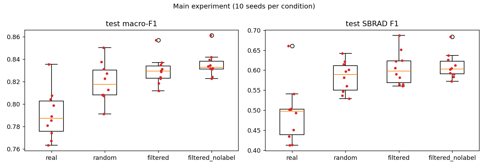

# Quality-Aware Synthetic Data Augmentation for Imbalanced ECG Rhythm Classification

*Draft report. Generated from the repository's result files; every number below links back to a file in the repo.*

## Abstract

We test whether quality-aware selection of synthetic ECGs improves an imbalanced 4-class rhythm classifier (PTB-XL,
SR ≈ 85 %) more than randomly selected synthetic ECGs. The Week-4 whole-ECG diffusion generator (adapted SSSD-ECG)
produced no regular heartbeat at the model size a 4 GB GPU allows, and a classifier trained on its samples alone scores
at chance on real data. It was replaced by **diffusion-generated beat templates assembled by a rule-based rhythm
model**, which carries most of the class information of real data (train-on-synthetic balanced accuracy 0.68 vs 0.87
for real ECGs). A quality score (class typicality, frozen-baseline label probability, realism-detector log-odds)
ranks the synthetic ECGs; top-ranked ones are clearly more useful than bottom-ranked ones (0.74 vs 0.58).

In the main experiment (CNN-LSTM, 10 seeds, test split), every *synthetic* augmentation improved significantly over
real-only training (macro-F1 0.791 → 0.820–0.835; SBRAD F1 0.49 → 0.58–0.61). Quality-filtered vs random synthetic data
looked slightly better (+0.010 macro-F1, 8/10 seeds, p = 0.065, not significant), so a **pre-registered confirmatory
study with 30 new seeds** was run. It found **no difference**: +0.0014 macro-F1, filtered better in 16/30 seeds,
two-sided Wilcoxon p = 0.79, 95 % CI −0.007 to +0.010. **At this mix ratio, quality-aware selection did not improve the
classifier over random selection**, although the quality score clearly separates more from less useful samples when
synthetic data is used alone (train-on-synthetic 0.74 top vs 0.58 bottom). Synthetic ECGs remain detectable by a CNN
(AUC 1.00), mainly through their inter-beat noise.

## 1. Problem and research question

PTB-XL v1.0.1 (100 Hz, 10 s, 12-lead) restricted to four mutually exclusive rhythm labels: sinus rhythm (SR),
atrial fibrillation (AFIB), sinus tachycardia (STACH) and sinus bradycardia (SBRAD). SR is ~85 % of the data.
A small CNN-LSTM trained on real data only (frozen *Baseline V1*) reaches test accuracy 0.918 and macro-F1 0.783,
but SBRAD F1 is only 0.497 (precision 0.36; 122 true-SR test ECGs are predicted SBRAD).

**Research question.** Can *quality-aware selection* of synthetic minority-class ECGs improve the classifier more than
adding the same number of *randomly chosen* synthetic ECGs?

## 2. Data and preprocessing (frozen, Weeks 1–2)

- Keep a recording iff exactly one of {SR, AFIB, STACH, SBRAD} is in `scp_codes` (19,759 recordings, 17,320 patients).
- Patient-level 70/15/15 split, seed 42, stratified on each patient's primary rhythm; zero patient overlap.
- Train: SR 11,741 / AFIB 1,056 / STACH 568 / SBRAD 446. Val 2,960. Test 2,988.
- Per-lead z-score with **train-only** statistics. Native 100 Hz records; no resampling, filtering or notch.
- Generators are trained on the train split only; val and test waveforms are never used for generation.

## 3. Baseline (frozen, Week 3)

CNN-LSTM, 46,756 parameters: Conv1d(12→32, k7)+BN+ReLU+MaxPool4 → Conv1d(32→64, k5)+BN+ReLU+MaxPool4 → LSTM(64)
→ Dropout 0.3 → Linear(4). Adam 1e-3, weight decay 1e-4, batch 64, ≤25 epochs, weighted cross-entropy
(w_c = n / 4n_c), early stopping and LR halving on val macro-F1. `baseline/metrics.json`:

| | SR | AFIB | STACH | SBRAD | macro |
|---|---|---|---|---|---|
| test F1 | 0.955 | 0.877 | 0.805 | **0.497** | 0.783 |
| test recall | 0.926 | 0.897 | 0.917 | 0.779 | 0.880 |

## 4. Evaluation framework for generators

Built because the original diagnostics were misleading (Section 5.1).

- **Heart-rate and rhythm metric** (`eval_metrics.lead_ii_hr_pt`): Pan-Tompkins-style QRS envelope on Lead II
  (5–15 Hz bandpass, derivative, square, 150 ms moving average), peak-count HR cross-checked against an
  autocorrelation period; *periodicity* = autocorrelation peak height. Real train ECGs: SR 70 / AFIB 85 / STACH 108 /
  SBRAD 49 bpm; periodicity ~0.84 (AFIB 0.36).
- **Scorecard** (`generator_comparison/scorecard.py`): 9 pass/fail checks of a pool against 256 real train ECGs per class
  (validity, amplitude, per-lead amplitude, heartbeat, HR order, HR error, spectral shape, diversity, memorisation).
  A held-out real pool scores 9/9.
- **Realism detector** (`realism_detector.py`): a fresh CNN trained to separate synthetic from real train ECGs;
  held-out AUC. 0.5 = indistinguishable.
- **TSTR** (`tstr.py`): train the baseline architecture on 440 synthetic ECGs per class only, test on the real
  validation split; balanced accuracy is the headline (val is 85 % SR). Reference: the same recipe on 440 real ECGs
  per class (TRTR).

## 5. Generator development

### 5.1 Starting point and a broken metric
The Week-4 generator was SSSD-ECG adapted to 4 classes and shrunk to 8×64 (1.53 M parameters) to fit a 4 GB GPU.
Its samples appeared to have class-independent heart rate (~130 bpm). That diagnosis came from a peak detector that
counted T and P waves (it measured real SBRAD at 96 bpm). With the corrected metric, every early pool had
**no regular heartbeat at all** (periodicity 0.13–0.18).

### 5.2 Diffusion experiments (all 8×64 unless noted; `generator_comparison/sssd_*`)

| change | finding |
|---|---|
| class-balanced sampling | no effect on periodicity |
| EMA weights | no effect |
| noise schedule β 1e-4→0.02 (T=200) leaves 36 % of the signal at t=T; rescaled to 5e-4→0.1 | spectral shape improved; amplitude blew up until training was longer |
| 80× training budget (320 k ECGs seen) | amplitude fixed; periodicity 0.16 |
| memorisation test (one ECG) | ε-prediction cannot reproduce even one training ECG (corr 0.29); **v-prediction** can (0.97) |
| v-prediction, full data | periodicity plateaus at ~0.22; best pool 6/9 |
| 16×128 (7.2 M) | same plateau (~0.25); better class HR ordering |

At this model size v-prediction is necessary but not sufficient. These pools carry little class information
(TSTR balanced accuracy 0.46 for the best one, 0.26 = chance for the Week-4 v1 generator; Section 6).

### 5.3 Beat-template generation with rule-based rhythm assembly (selected)
Rhythm is supplied by a statistical model; only beat morphology is learned.

1. **Templates.** For each train ECG, R-peaks are detected and a fixed absolute-time window (R−250 ms … R+450 ms,
   70 samples, 8 independent leads, 0.5 Hz high-pass) is cut around each beat; the per-recording median beat is
   baseline-zeroed and tapered. Fixed windows keep QRS width independent of heart rate. 13,244 clean templates.
2. **Template generator.** v-prediction SSSD backbone (8×64, `s4_lmax` 70), class-conditional, class-balanced
   sampling, 15 k steps, EMA weights. Generated templates are as close to real templates as real templates are to each
   other (nearest-real correlation 0.89–0.93 vs real-to-real 0.88–0.94) and none is a copy (> 0.98).
3. **Assembly.** Per class: RR series from a KDE over real (mean RR, RR coefficient of variation), smooth AR(1)
   variability for sinus classes and independent gamma RRs for AFIB; templates placed by overlap-add with
   respiratory amplitude modulation; residual (noise, beat-to-beat variation, AFIB f-waves) and baseline wander added
   as Gaussian processes with the real 8×8 cross-spectrum; leads III, aVR, aVL, aVF derived in mV space.

Validation of the decomposition (`beat_templates/roundtrip.json`, `scorecard/detector_ablation_*.json`): rebuilding real ECGs from their own template at their own
R-peaks gives correlation 0.81 (AFIB) – 0.92 (SBRAD), and with their own residual the result is indistinguishable from
real (detector AUC 0.49–0.51).

## 6. Generator comparison

TSTR, 440 ECGs per class, real validation split, 3 seeds (`generator_comparison/tstr/tstr_results.md`):

| trained on | balanced acc | recall SR / AFIB / STACH / SBRAD |
|---|---|---|
| real ECGs | **0.873** | 0.79 / 0.84 / 0.93 / 0.94 |
| beat assembly, real templates (oracle) | 0.721 | 0.60 / 0.43 / 0.89 / 0.97 |
| **beat assembly, generated templates** | **0.678** | 0.60 / 0.46 / 0.75 / 0.90 |
| diffusion, v-prediction 8×64 | 0.459 | 0.21 / 0.44 / 0.30 / 0.89 |
| diffusion, Week-4 v1 | 0.259 | 0.98 / 0.01 / 0.05 / 0.00 |

Scorecard of the selected generator: 8/9 (typical amplitude ~12 % above real). Realism detector: AUC 1.00 —
see Limitations.

## 7. Quality filter (Week 5)

Each synthetic ECG gets three scores (`generator_comparison/quality_filter.py`):
- **typicality** – class-conditional percentile typicality of rhythm (periodicity, HR, HR-estimator disagreement),
  amplitude (8 per-lead std) and spectral shape, against real train ECGs of the same class;
- **label** – the frozen baseline's probability of the intended class (scorer only);
- **realism** – out-of-fold detector log-odds of "real" (5-fold cross-fitting).

The quality score is the mean within-class percentile rank of the three. `score_nolabel` drops the baseline component.

**Sanity check** (`tstr/filter_check.md`): from a final pool of 3,200 AFIB / 1,800 STACH / 1,400 SBRAD generated ECGs,
TSTR on 440 per class gives top-scored **0.743** > random 0.672 > bottom-scored 0.582 balanced accuracy.

## 8. Main experiment

**Design** (`augment_experiment.py`, `experiment/main/`). Baseline CNN-LSTM recipe unchanged (Section 3), class weights
recomputed from each condition's training labels, epoch selected on val macro-F1. Test predictions were analysed once
for the four planned conditions; the oversampling control and the revised statistics (seed-level bootstrap, Holm
families) were added **after** that analysis and the statistics were rerun (see Limitations).
Each minority class is doubled (+1,056 AFIB, +568 STACH, +446 SBRAD = 2,070 added ECGs); SR is unchanged. Conditions:

| condition | added training ECGs |
|---|---|
| real | none |
| oversample *(control, added after the first analysis)* | each real minority ECG duplicated once |
| random | 2,070 synthetic, drawn at random from the final pool (new draw per seed) |
| filtered | the 2,070 top-scored synthetic (same set for every seed) |
| filtered_nolabel | as filtered, ranked without the frozen-baseline component (robustness check, specified before the main run) |

10 seeds per condition. Primary test (specified in the plan): **filtered vs random, test macro-F1**, paired Wilcoxon
signed-rank by seed. The other comparisons were grouped into families A–C with Holm correction **after** the first
statistics run (`stats.py`); treat them as secondary/exploratory. Confidence intervals come from a two-level bootstrap
over test patients and training seeds.

**Results** (`experiment/main/stats.md`):

| condition | test macro-F1 (mean ± sd) | 95 % CI | test SBRAD F1 | 95 % CI |
|---|---|---|---|---|
| real | 0.791 ± 0.022 | 0.765–0.815 | 0.491 ± 0.073 | 0.410–0.567 |
| oversample | 0.814 ± 0.013 | 0.790–0.836 | 0.545 ± 0.047 | 0.470–0.612 |
| random | 0.820 ± 0.017 | 0.795–0.844 | 0.583 ± 0.039 | 0.507–0.653 |
| filtered | 0.830 ± 0.012 | 0.806–0.853 | 0.605 ± 0.042 | 0.526–0.675 |
| filtered_nolabel | **0.835 ± 0.011** | 0.812–0.858 | **0.610 ± 0.032** | 0.531–0.680 |

The real-only condition (10 seeds) matches the frozen single-seed baseline (0.783).

| comparison | metric | diff | dz | Wilcoxon p | Holm p | seeds better |
|---|---|---|---|---|---|---|
| **PRIMARY: filtered − random** | macro-F1 | +0.010 | 0.63 | **0.065** | — | 8/10 |
| A: random − real | macro-F1 / SBRAD | +0.029 / +0.092 | 1.15 / 1.28 | 0.010 / 0.010 | 0.039 / 0.039 | 9 / 8 |
| A: filtered − real | macro-F1 / SBRAD | +0.039 / +0.114 | 1.51 / 1.28 | 0.002 / 0.006 | 0.016 / 0.029 | 10 / 9 |
| A: oversample − real | macro-F1 / SBRAD | +0.023 / +0.054 | 0.75 / 0.56 | 0.106 / 0.106 | 0.211 / 0.211 | 6 / 7 |
| B: random − oversample | macro-F1 / SBRAD | +0.006 / +0.038 | 0.28 / 0.62 | 0.557 / 0.020 | 0.557 / 0.059 | 7 / 9 |
| B: filtered − oversample | macro-F1 / SBRAD | +0.016 / +0.060 | 0.99 / 1.23 | 0.027 / 0.006 | 0.059 / **0.029** | 8 / 9 |
| B: filtered_nolabel − oversample | macro-F1 / SBRAD | +0.022 / +0.065 | 1.47 / 1.39 | 0.010 / 0.004 | **0.039 / 0.023** | 8 / 9 |
| C: filtered_nolabel − random | macro-F1 | +0.016 | 1.06 | 0.020 | 0.059 | 9/10 |

(Full table, including paired t-tests and bootstrap intervals of each difference: `experiment/main/stats.md`.)

**Interpretation.**
1. *Research question.* Quality-aware selection gave a small, directionally consistent gain over random selection
   (+0.010 to +0.016 macro-F1 in 8–9 of 10 seeds, in both filter variants and both metrics), but the pre-specified
   comparison is **not significant** (p = 0.065; bootstrap 95 % CI of the difference −0.002 to +0.021). Detecting an
   effect of this size (dz ≈ 0.6) with 80 % power would take about 22 seeds; that should be a new confirmatory run,
   not more seeds added to this one.
2. *Synthetic augmentation helps.* Every synthetic condition beats real-only after Holm correction; SBRAD F1 rises from
   0.49 to 0.58–0.61. Duplicating real minority ECGs alone is not significant (Holm p 0.21).
3. *Post hoc: mostly through more minority examples, unless the samples are filtered.* In the oversampling control
   (added after the first test-set analysis), duplicating real minority ECGs recovers most of the random-synthetic gain,
   and random synthetic data is not significantly better than duplication; only the quality-filtered conditions beat
   duplication after correction (SBRAD F1 for both filters; macro-F1 for the no-label filter). This is exploratory,
   hypothesis-generating support for quality-aware selection, not a substitute for the primary test.
4. *The filter does not just echo the baseline.* Dropping the frozen-baseline component did not hurt (no-label vs full:
   +0.006 macro-F1, exploratory, CI includes 0).
5. Lower seed-to-seed spread of the augmented conditions vs real-only reflects training stability. It cannot be credited to
   filtering versus random, because random also varies its synthetic subset between seeds.

### 8.1 Pre-registered confirmatory study

Because the exploratory primary comparison was underpowered, a confirmatory run was registered before it started
(`report/PREREGISTRATION.md`, commit `803a2b7`): filtered vs random only, **30 new seeds (100–129)**, identical pool,
scores and recipe (SHA-256 verified), exactly 30 seeds with no interim look, two-sided Wilcoxon on test macro-F1,
α = 0.05, frozen analysis `_confirmatory_analysis.py` run once (`experiment/confirmatory/confirmatory_result.md`).

| | exploratory (seeds 0–9) | **confirmatory (seeds 100–129)** |
|---|---|---|
| filtered macro-F1 | 0.830 | 0.831 |
| random macro-F1 | 0.820 | 0.830 |
| mean difference | +0.010 | **+0.0014** |
| filtered better | 8/10 | **16/30** |
| Wilcoxon p (two-sided) | 0.065 | **0.79** |
| 95 % CI of difference | −0.002 to +0.021 | −0.007 to +0.010 |
| SBRAD F1 difference | +0.022 | −0.004 (13/30) |

**Decision (pre-specified): H1 not supported.** The filtered condition performed the same in both studies; the random
condition's first ten seeds were low by chance, which produced the exploratory gap. The confirmatory interval excludes any
gain larger than about +0.01 macro-F1.

**Consequence for the exploratory findings.** The post-hoc result "filtered beats duplicated real data, random does not"
(Section 8, point 3) rested on the same ten random-condition seeds that the confirmatory run shows were unusually low;
it should not be taken as evidence for quality-aware selection. The conclusions that stand are: synthetic minority
augmentation improves over real-only training, and the quality score ranks samples by usefulness when synthetic data
is used alone (TSTR), but this ranking does not translate into a measurable gain when synthetic data is *added* to the
real training set at ratio 1.0.

**Possible reasons (untested).** With 11,741 real SR and the full real minority set already present, the classifier may
gain mainly from more minority examples and rebalanced class weights, which any synthetic subset provides; the quality
differences between filtered and random subsets (both drawn from the same, already reasonably good pool) may be too small
to matter at this ratio. Higher synthetic ratios, a weaker pool, or a stricter filter could behave differently.

## 9. Limitations

- **Synthetic ECGs are detectable** (realism detector AUC 1.00). Ablations show why: the residual left after removing the
  median beat is beat-locked in real ECGs, while ours is a stationary Gaussian process, visibly noisier between beats.
  Gains on the real test set show it did not prevent learning, but a classifier could use it as a shortcut.
- **Rhythm is constructed, not learned**: RR series come from fitted per-class distributions; AFIB atrial activity is
  parametric (residual Gaussian process). The learned part of the generator is beat morphology only.
- Typical amplitude ~12 % above real (scorecard amplitude check fails); noise and wander scales are sampled independently.
- **Scope**: one mix ratio (1.0), one generator, one classifier architecture. The confirmatory study (30 seeds) rules
  out a filtered-vs-random gain above ~+0.01 macro-F1 in this setting only.
- The whole-ECG diffusion route was limited by a 4 GB GPU (8×64 and 16×128 tried; the published 36×256 was not).
- **Decisions made after seeing intermediate results.** Before any test-set use: scorecard validity recalibrated to the
  real rate of |z| > 20 (~1 %); filter components combined as ranks and detector log-odds after probabilities saturated;
  `score_nolabel` added before the main run. **After the first test-set statistics run:** the oversampling control was
  added and trained; the bootstrap was changed to also resample seeds (the patient-only version gave a difference CI
  excluding 0 next to a non-significant per-seed test); the Holm families A–C were defined. The primary comparison and
  its test were fixed in the plan and are unaffected. The validation split was used for TSTR, the filter sanity check and
  early stopping.
- Baseline CNN-LSTM confidence is one of the filter's inputs (the no-label variant shows the result does not depend on it).

## 10. Reproducibility

The main experiment and the generator comparison are reproducible with the commands in the repository `README.md`
("Reproduce the main result" and "Reproduce the generator comparison"); the diffusion runs of Section 5.2 have their own
scripts in `test/` (see `test/README.md`) and `RESULT.md` notes. Hardware: RTX 3050 Laptop 4 GB; template
generator ~30 min, final pool ~7 min, quality scoring ~15 min, main experiment (50 runs) ~30 min. Seeds: split 42;
template generator 42; final pool 7; experiment seeds 0–9. Package versions are pinned in `requirements.txt`. Large
intermediates (pools, templates, checkpoints) are gitignored and rebuilt by the listed scripts.
