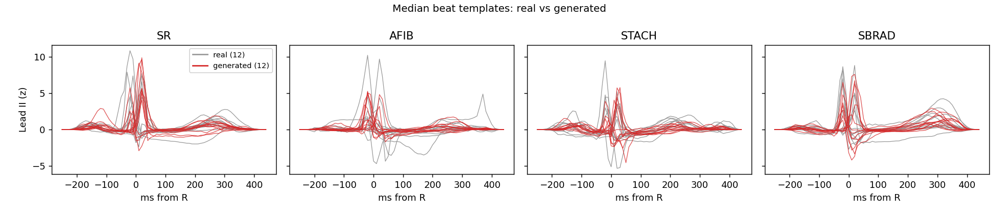
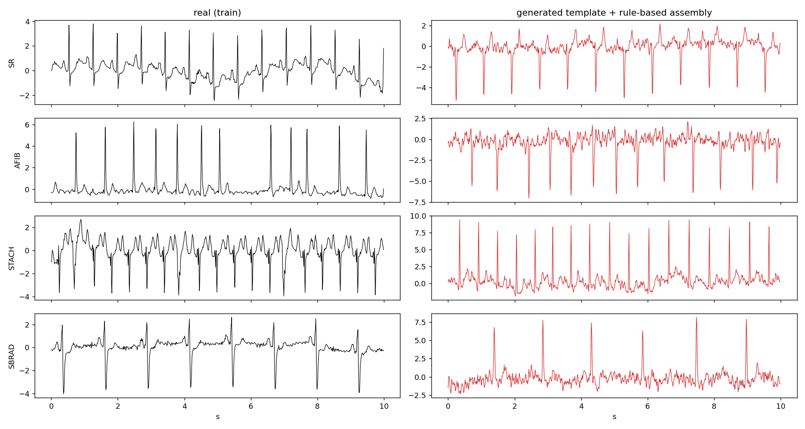
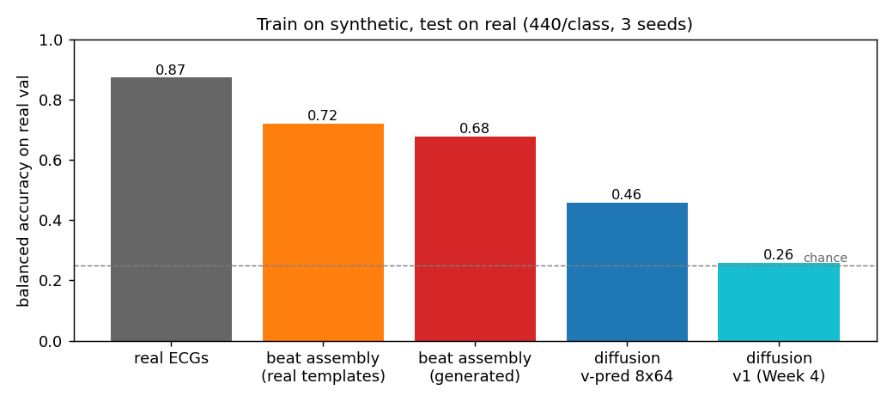

# Quality-Aware Synthetic Data Augmentation for Imbalanced ECG Rhythm Classification

*Draft report. Generated from the repository's result files; every number below links back to a file in the repo.*

## Abstract

<!-- ABSTRACT: filled after Phase 4 -->

## 1. Problem and research question

PTB-XL v1.0.1 (100 Hz, 10 s, 12-lead) restricted to four mutually exclusive rhythm labels: sinus rhythm (SR),
atrial fibrillation (AFIB), sinus tachycardia (STACH) and sinus bradycardia (SBRAD). SR is ~85 % of the data.
A small CNN-LSTM trained on real data only (frozen *Baseline V1*) reaches test accuracy 0.918 and macro-F1 0.783,
but SBRAD F1 is only 0.497 (precision 0.36; 122 true-SR test ECGs are predicted SBRAD).

**Research question.** Can *quality-aware selection* of synthetic minority-class ECGs improve the classifier more than
adding the same number of *randomly chosen* synthetic ECGs?

## 2. Data and preprocessing (frozen, Weeks 1–2)

- Keep a recording iff exactly one of {SR, AFIB, STACH, SBRAD} is in `scp_codes` (19,759 recordings, 17,320 patients).
- Patient-level 70/15/15 split, seed 42, stratified on each patient's primary rhythm; zero patient overlap.
- Train: SR 11,741 / AFIB 1,056 / STACH 568 / SBRAD 446. Val 2,960. Test 2,988.
- Per-lead z-score with **train-only** statistics. Native 100 Hz records; no resampling, filtering or notch.
- Generators are trained on the train split only; val and test waveforms are never used for generation.

## 3. Baseline (frozen, Week 3)

CNN-LSTM, 46,756 parameters: Conv1d(12→32, k7)+BN+ReLU+MaxPool4 → Conv1d(32→64, k5)+BN+ReLU+MaxPool4 → LSTM(64)
→ Dropout 0.3 → Linear(4). Adam 1e-3, weight decay 1e-4, batch 64, ≤25 epochs, weighted cross-entropy
(w_c = n / 4n_c), early stopping and LR halving on val macro-F1. `baseline/metrics.json`:

| | SR | AFIB | STACH | SBRAD | macro |
|---|---|---|---|---|---|
| test F1 | 0.955 | 0.877 | 0.805 | **0.497** | 0.783 |
| test recall | 0.926 | 0.897 | 0.917 | 0.779 | 0.880 |

## 4. Evaluation framework for generators

Built because the original diagnostics were misleading (Section 5.1).

- **Heart-rate and rhythm metric** (`eval_metrics.lead_ii_hr_pt`): Pan-Tompkins-style QRS envelope on Lead II
  (5–15 Hz bandpass, derivative, square, 150 ms moving average), peak-count HR cross-checked against an
  autocorrelation period; *periodicity* = autocorrelation peak height. Real train ECGs: SR 70 / AFIB 85 / STACH 108 /
  SBRAD 49 bpm; periodicity ~0.84 (AFIB 0.36).
- **Scorecard** (`generator_comparison/scorecard.py`): 9 pass/fail checks of a pool against 256 real train ECGs per class
  (validity, amplitude, per-lead amplitude, heartbeat, HR order, HR error, spectral shape, diversity, memorisation).
  A held-out real pool scores 9/9.
- **Realism detector** (`realism_detector.py`): a fresh CNN trained to separate synthetic from real train ECGs;
  held-out AUC. 0.5 = indistinguishable.
- **TSTR** (`tstr.py`): train the baseline architecture on 440 synthetic ECGs per class only, test on the real
  validation split; balanced accuracy is the headline (val is 85 % SR). Reference: the same recipe on 440 real ECGs
  per class (TRTR).

## 5. Generator development

### 5.1 Starting point and a broken metric
The Week-4 generator was SSSD-ECG adapted to 4 classes and shrunk to 8×64 (1.53 M parameters) to fit a 4 GB GPU.
Its samples appeared to have class-independent heart rate (~130 bpm). That diagnosis came from a peak detector that
counted T and P waves (it measured real SBRAD at 96 bpm). With the corrected metric, every early pool had
**no regular heartbeat at all** (periodicity 0.13–0.18).

### 5.2 Diffusion experiments (all 8×64 unless noted; `generator_comparison/sssd_*`)

| change | finding |
|---|---|
| class-balanced sampling | no effect on periodicity |
| EMA weights | no effect |
| noise schedule β 1e-4→0.02 (T=200) leaves 36 % of the signal at t=T; rescaled to 5e-4→0.1 | spectral shape improved; amplitude blew up until training was longer |
| 80× training budget (320 k ECGs seen) | amplitude fixed; periodicity 0.16 |
| memorisation test (one ECG) | ε-prediction cannot reproduce even one training ECG (corr 0.29); **v-prediction** can (0.97) |
| v-prediction, full data | periodicity plateaus at ~0.22; best pool 6/9 |
| 16×128 (7.2 M) | same plateau (~0.25); better class HR ordering |

At this model size v-prediction is necessary but not sufficient. These pools carry little class information
(TSTR balanced accuracy 0.46 for the best one, 0.26 = chance for the Week-4 v1 generator; Section 6).

### 5.3 Beat-template generation with rule-based rhythm assembly (selected)
Rhythm is supplied by a statistical model; only beat morphology is learned.

1. **Templates.** For each train ECG, R-peaks are detected and a fixed absolute-time window (R−250 ms … R+450 ms,
   70 samples, 8 independent leads, 0.5 Hz high-pass) is cut around each beat; the per-recording median beat is
   baseline-zeroed and tapered. Fixed windows keep QRS width independent of heart rate. 13,244 clean templates.
2. **Template generator.** v-prediction SSSD backbone (8×64, `s4_lmax` 70), class-conditional, class-balanced
   sampling, 15 k steps, EMA weights. Generated templates are as close to real templates as real templates are to each
   other (nearest-real correlation 0.89–0.93 vs real-to-real 0.88–0.94) and none is a copy (> 0.98).
3. **Assembly.** Per class: RR series from a KDE over real (mean RR, RR coefficient of variation), smooth AR(1)
   variability for sinus classes and independent gamma RRs for AFIB; templates placed by overlap-add with
   respiratory amplitude modulation; residual (noise, beat-to-beat variation, AFIB f-waves) and baseline wander added
   as Gaussian processes with the real 8×8 cross-spectrum; leads III, aVR, aVL, aVF derived in mV space.

Validation of the decomposition (Fig. 2 in `beat_templates/`): rebuilding real ECGs from their own template at their own
R-peaks gives correlation 0.81 (AFIB) – 0.92 (SBRAD), and with their own residual the result is indistinguishable from
real (detector AUC 0.49–0.51).

## 6. Generator comparison

TSTR, 440 ECGs per class, real validation split, 3 seeds (`generator_comparison/tstr/tstr_results.md`):

| trained on | balanced acc | recall SR / AFIB / STACH / SBRAD |
|---|---|---|
| real ECGs | **0.873** | 0.79 / 0.84 / 0.93 / 0.94 |
| beat assembly, real templates (oracle) | 0.721 | 0.60 / 0.43 / 0.89 / 0.97 |
| **beat assembly, generated templates** | **0.678** | 0.60 / 0.46 / 0.75 / 0.90 |
| diffusion, v-prediction 8×64 | 0.459 | 0.21 / 0.44 / 0.30 / 0.89 |
| diffusion, Week-4 v1 | 0.259 | 0.98 / 0.01 / 0.05 / 0.00 |

Scorecard of the selected generator: 8/9 (typical amplitude ~12 % above real). Realism detector: AUC 1.00 —
see Limitations.

## 7. Quality filter (Week 5)

Each synthetic ECG gets three scores (`generator_comparison/quality_filter.py`):
- **typicality** – class-conditional percentile typicality of rhythm (periodicity, HR, HR-estimator disagreement),
  amplitude (8 per-lead std) and spectral shape, against real train ECGs of the same class;
- **label** – the frozen baseline's probability of the intended class (scorer only);
- **realism** – out-of-fold detector log-odds of "real" (5-fold cross-fitting).

The quality score is the mean within-class percentile rank of the three. `score_nolabel` drops the baseline component.

**Sanity check** (`tstr/filter_check.md`): from a final pool of 3,200 AFIB / 1,800 STACH / 1,400 SBRAD generated ECGs,
TSTR on 440 per class gives top-scored **0.743** > random 0.672 > bottom-scored 0.582 balanced accuracy.

## 8. Main experiment

<!-- RESULTS: filled after Phase 4 -->

## 9. Limitations

<!-- LIMITATIONS: filled after Phase 4 -->

## 10. Reproducibility

<!-- REPRO: filled after Phase 4 -->
